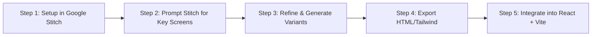

# Frontend Development Master Plan (with Google Stitch)
> **Target Audience:** Frontend Teammate  
> **Mission:** Build a high-impact, award-winning UI using **Google Stitch** for rapid AI-driven prototyping, then implement it in **React + Vite + Tailwind CSS**.

---

## 1. Quick Overview of Your Workflow

You will use **Google Stitch** to generate production-grade UI screens and design systems in minutes, rather than designing from scratch in Figma or writing raw CSS.



### The Hackathon Time Advantage:
- **No waiting for backend:** You will use the pre-built mock data in Section 5 so your UI is 100% functional from minute one.
- **Visual WOW Factor:** Google Stitch generates sleek, modern glassmorphic layouts with cohesive typography and color tokens.

---

## 2. Setting Up Google Stitch

1. Open **Google Stitch** and click **New Project** (Title: `NyayaSutra - Legal Document Review` or `Corporate Risk Radar`).
2. **Set Design Tokens & Theme**:
   - **Mode:** Dark Mode (preferred by hackathon judges for modern tech/AI feel) or Clean Neo-Fintech / Legal Slate.
   - **Primary Palette:** Deep Navy (`#0B0F19`), Slate Grey (`#1E293B`), Accent Emerald/Cyan (`#10B981` / `#06B6D4`) for success/allowed, Coral Red (`#EF4444`) for high-risk/dismissed, Warm Amber (`#F59E0B`) for pending.
   - **Font:** Inter / Outfit / Plus Jakarta Sans.

---

## 3. Screen Blueprints & Exact Google Stitch Prompts

Copy-paste these exact prompts into Google Stitch to generate the prototypes.

---

### Project Option A: Legal Court Document Review (*Recommended / Selected*)
> **Tool Concept:** "NyayaSutra" - Indian Court Judgment Triage & Statutory Intelligence Suite

#### Screen 1: Dashboard Home & Upload Zone
* **Prompt to paste into Google Stitch:**
  > *"A modern, dark-mode legaltech web application dashboard for Indian court judgments called 'NyayaSutra'. Top navbar with app title, quick search bar, and 'Upload Judgment' button. Main hero has a drag-and-drop PDF upload zone with dashed border, legal gavel/document icon, supporting files up to 50MB. Below the upload zone, a 'Sample Benchmark Judgments' shelf showing 4 clickable case cards (e.g., Supreme Court Bail Order, High Court Section 138 Cheque Bounce, Commercial Arbitration, Writ Petition under Art 226) with case number, court badge, and quick triage tags."*

#### Screen 2: Split-Screen Judgment Dossier (The Core Screen)
* **Prompt to paste into Google Stitch:**
  > *"A high-density split-screen document review workspace for legal professionals. Left pane (50% width): An interactive PDF viewer with dark toolbar (zoom, page jumper, text highlighter, jump to sections). Right pane (50% width): Intelligent Case Dossier with glassmorphic cards:*
  > *1. Top Header: Case Title ('State of Maharashtra vs. XYZ'), Case Number, Court ('Supreme Court of India'), Coram/Bench names, and a prominent badge: 'DISPOSITION: BAIL GRANTED' with a green glowing pill.*
  > *2. Tab Bar: 'Executive Summary', 'Statutory Acts & Sections', 'Parties & Arguments', 'Citizen Mode (Simple)'.*
  > *3. Statutory Sections Card: Badges for cited acts like 'Section 438 CrPC (Anticipatory Bail)', 'Section 420 IPC (Cheating)', with expandable 1-sentence plain-English explanations.*
  > *4. Dual Summary Toggle: Switch between 'Advocate Headnotes (Ratio Decidendi)' and 'Citizen Plain Language' with language selector (English / Hindi / Marathi).*
  > *5. Action Bar: 'Export Summary PDF', 'Copy Headnote', 'Ask Case AI'."*

#### Screen 3: "Ask the Judgment" Interactive Drawer / Modal
* **Prompt to paste into Google Stitch:**
  > *"An AI conversational drawer sliding in from the right over the legal document viewer. Header says 'Ask Nyaya AI - Grounded in Current Judgment'. Chat history showing user asking 'Why was bail granted?' and AI replying with exact page citation (Page 14, Para 22) and quoted excerpt. Input box at bottom with suggested quick prompts ('What is the ratio decidendi?', 'List all precedents cited', 'Explain in Hindi')."*

---

### Project Option B: Automated Corporate Risk Radar (*Alternative*)
> In case your team decides to build the Corporate Risk Radar:

#### Screen 1: 5-Company Live Risk Scoreboard & Radar
* **Prompt to paste into Google Stitch:**
  > *"A dark-mode fintech executive risk dashboard called 'Corporate Risk Radar'. Top ticker shows 5 target companies (Boeing, Wells Fargo, Tesla, Meta, CrowdStrike). Each company card displays: Ticker, Company Logo, Rolling Corporate Risk Index (CRI score 0-100) with radial gauge, 24h delta (+14.2% in red), Risk Band badge ('ELEVATED RISK'), and a 2-sentence AI executive summary. Center section features a 4-axis Spider/Radar chart breaking down Legal, Operational, Compliance, and Reputational risk pillars."*

#### Screen 2: Real-time Alert Triage Stream & Crisis Shock Trigger
* **Prompt to paste into Google Stitch:**
  > *"A live real-time regulatory alert feed component. Each item has a timestamp, source credibility badge (e.g., 'SEC 8-K', 'CFPB Enforcement', 'Reuters'), category pill, severity meter (1-10), and a highlighted AI 'Why This Matters' explanation. In the top corner, an interactive 'Crisis Demo Injector' dropdown button allowing the user to trigger pre-configured shock events (e.g., 'Boeing FAA Subpoena') to demonstrate instant risk score recalculation."*

---

## 4. Converting Stitch Prototypes to React + Tailwind

Once Google Stitch generates your screen designs:

1. **Export the Code / Inspect Elements**:
   - In Stitch, click **Inspect / Code** to grab the Tailwind classes and layout structures.
2. **Organize Component Hierarchy in React**:
   ```text
   frontend/
   ├── src/
   │   ├── components/
   │   │   ├── Navbar.jsx           # Brand header, search, upload trigger
   │   │   ├── UploadZone.jsx       # Drag & drop PDF uploader
   │   │   ├── SampleCaseSelector.jsx # Quick 1-click test cases for judges
   │   │   ├── SplitView/
   │   │   │   ├── DocumentViewer.jsx # Left pane: PDF rendering / highlights
   │   │   │   ├── DossierHeader.jsx  # Case title, Bench, Disposition pill
   │   │   │   ├── StatutoryCards.jsx # IPC / CrPC / Act badges & explainers
   │   │   │   ├── SummaryTabs.jsx    # Lawyer Headnote vs Citizen View
   │   │   │   └── CaseChatDrawer.jsx # "Ask the Judgment" interactive RAG chat
   │   │   └── common/
   │   │       ├── Badge.jsx
   │   │       └── Card.jsx
   │   ├── mock/
   │   │   └── mockCaseData.js      # Mock API response (see Section 5)
   │   ├── App.jsx
   │   └── main.jsx
   ```

3. **Install Recommended Frontend Packages**:
   ```bash
   npm create vite@latest frontend -- --template react
   cd frontend
   npm install -D tailwindcss postcss autoprefixer
   npx tailwindcss init -p
   npm install lucide-react clsx tailwind-merge
   # Optional: For PDF viewing & animations
   npm install react-pdf framer-motion
   ```

---

## 5. Mock Data Contract (Start Coding Without Backend!)

Create `frontend/src/mock/mockCaseData.js` and paste this directly:

```javascript
export const MOCK_CASES = [
  {
    id: "case_01",
    title: "Arnesh Kumar vs. State of Bihar & Anr.",
    case_number: "Criminal Appeal No. 1277 of 2014",
    court: "Supreme Court of India",
    date: "July 2, 2014",
    coram: ["Hon'ble Justice Chandramauli Kumar Prasad", "Hon'ble Justice Pinaki Chandra Ghose"],
    disposition: {
      status: "ALLOWED",
      badge_color: "emerald",
      verdict_text: "Arrest Guidelines Mandated / Bail Safeguards Issued"
    },
    case_type: "CRIMINAL",
    statutes_cited: [
      {
        act: "Indian Penal Code, 1860",
        section: "Section 498-A",
        description: "Husband or relative of husband subjecting woman to cruelty.",
        context_in_case: "Allegations of harassment and dowry demand without preliminary inquiry."
      },
      {
        act: "Code of Criminal Procedure, 1973",
        section: "Section 41 & 41A",
        description: "Notice of appearance before police officer instead of mandatory arrest.",
        context_in_case: "Police must satisfy necessity of arrest before taking accused into custody."
      }
    ],
    lawyer_headnote: "The Supreme Court held that police officers shall not automatically arrest accused persons under Section 498-A IPC without satisfying the parameters laid down under Section 41 CrPC. Magistrates must inspect the checklist before authorizing detention.",
    citizen_summary_en: "Police cannot arrest someone automatically just because a dowry or domestic harassment complaint is filed. They must give a notice to appear first and only arrest if strictly necessary.",
    citizen_summary_hi: "पुलिस सिर्फ दहेज या उत्पीड़न की शिकायत दर्ज होने पर किसी को तुरंत गिरफ्तार नहीं कर सकती। पहले पेशी का नोटिस देना अनिवार्य है।",
    pdf_sample_url: "https://example.com/sample.pdf"
  },
  {
    id: "case_02",
    title: "Dashrath Rupsingh Rathod vs. State of Maharashtra",
    case_number: "Criminal Appeal No. 2287 of 2009",
    court: "Supreme Court of India",
    date: "August 1, 2014",
    coram: ["Hon'ble Chief Justice R.M. Lodha", "Hon'ble Justice Kurian Joseph", "Hon'ble Justice R.F. Nariman"],
    disposition: {
      status: "DISPOSED OF WITH DIRECTIONS",
      badge_color: "amber",
      verdict_text: "Jurisdiction Determined / Remanded to Appropriate Forum"
    },
    case_type: "COMMERCIAL / CRIMINAL",
    statutes_cited: [
      {
        act: "Negotiable Instruments Act, 1881",
        section: "Section 138",
        description: "Dishonour of cheque for insufficiency of funds in the bank account.",
        context_in_case: "Determining where a cheque bounce complaint can be legally filed."
      }
    ],
    lawyer_headnote: "Territorial jurisdiction for initiating complaint under Section 138 NI Act lies exclusively at the place where the drawee bank is located.",
    citizen_summary_en: "If a cheque bounces, the legal case must be filed in the court where the payee's bank branch is located, not anywhere else.",
    citizen_summary_hi: "यदि चेक बाउंस होता है, तो कानूनी मामला उसी बैंक शाखा के अधिकार क्षेत्र वाली अदालत में दर्ज किया जाएगा।",
    pdf_sample_url: "https://example.com/sample2.pdf"
  }
];
```

---

## 6. Hackathon Winning UX Checklist

- [ ] **Sample Selector Pills**: Put 3-4 sample cases at the top of the screen so judges don't have to search for a PDF on their laptop. One click loads the full case instantly.
- [ ] **Color Coded Outcomes**:
  - `BAIL GRANTED` / `PETITION ALLOWED` $\rightarrow$ Glowing Emerald (`#10B981`)
  - `DISMISSED` / `REJECTED` $\rightarrow$ Vibrant Crimson (`#EF4444`)
  - `PARTLY ALLOWED` / `DIRECTIONS ISSUED` $\rightarrow$ Golden Amber (`#F59E0B`)
- [ ] **Language Switcher**: A simple toggle button (`English` | `हिंदी` | `मराठी`) for the Citizen Summary. Judges in India **love** multilingual accessibility features.
- [ ] **Responsive / Clean**: Ensure the split pane collapses smoothly into stacked cards on smaller laptop screens.
- [ ] **Loading Skeleton**: Add a pulse animation (`animate-pulse`) when a new document is being parsed ("AI Extracting Statutory Clauses...").

---

## 7. Connecting to the Backend (When Ready)

When your backend teammate provides the FastAPI server:
1. Replace `MOCK_CASES` with a single fetch:
   ```javascript
   const analyzeDocument = async (file) => {
     const formData = new FormData();
     formData.append("file", file);
     const res = await fetch("http://localhost:8000/api/document/analyze", {
       method: "POST",
       body: formData
     });
     return await res.json();
   };
   ```
2. The JSON returned by the backend will match the exact same structure as `mockCaseData.js`. Zero refactoring needed!
